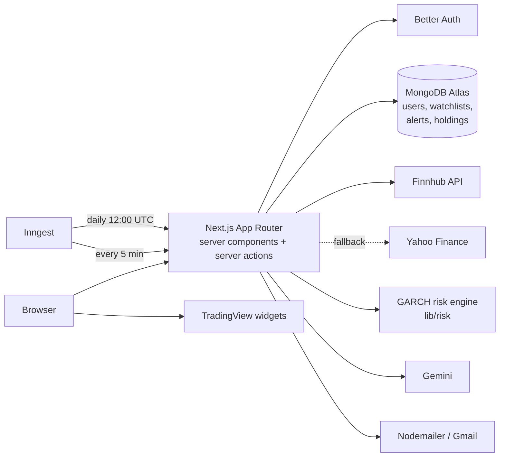

# FinSight

**Stock tracking, price alerts and risk forecasts in one place.**

FinSight is a full-stack investing dashboard built with Next.js and MongoDB. Users keep a watchlist, get emailed when a stock crosses a price target, track their portfolio's profit and loss, and see how risky each stock (and their whole portfolio) is likely to be tomorrow, using a GARCH volatility model that is backtested against real market data.

     

**Live demo: [fin-sight-2bsf.vercel.app](https://fin-sight-2bsf.vercel.app)** (create a free account to try it)

---

## Features

| | |
|---|---|
| **Watchlist** | Search any US stock (Ctrl+K), star it, and track live price and daily change. |
| **Price alerts** | "Email me when AAPL rises above $400." A background job checks every active alert every 5 minutes and sends the email exactly once. |
| **Portfolio tracker** | Record holdings with shares and buy price. Live value, profit and loss, daily change and position weights; repeat buys update the average cost. |
| **Risk forecast** | For every stock and for the whole portfolio: tomorrow's typical move, yearly volatility, and the possible loss on a bad day (1 in 20) or very bad day (1 in 100). |
| **Model backtest** | Each risk forecast is checked against the last two years of real prices and compared with three other methods (see below). |
| **Stock summary & portfolio review** | Plain-English summaries tailored to the user's goals and risk tolerance, generated server-side with Gemini. |
| **Emails** | Personalised welcome email, daily news digest for the user's watchlist, and price-alert emails. |
| **Dashboard** | Portfolio value, today's change, active alerts, biggest movers, plus market overview, heatmap and news widgets. |

---

## The risk model

Predicting tomorrow's *price* is close to impossible: in testing, an AR(1) return model got the direction right on about 50% of days, the same as a coin flip. Predicting tomorrow's *risk* is much more reliable, because volatility clusters: calm days tend to follow calm days, and turbulent days follow turbulent days. FinSight models that with **GARCH(1,1)**:

```
σ²ₜ = ω + α·ε²ₜ₋₁ + β·σ²ₜ₋₁
```

- **α** controls how strongly yesterday's surprise raises today's risk; **β** controls how long elevated risk persists.
- Parameters are fitted by **maximum likelihood** with a Nelder-Mead optimiser, written from scratch in TypeScript (no statistics library). A test on simulated data recovers known parameters (α = 0.102 vs 0.100, β = 0.851 vs 0.850).
- **Value-at-Risk** uses *filtered historical simulation*: tomorrow's GARCH volatility multiplied by the empirical quantiles of the model's own standardised residuals, which captures fat tails that a normal distribution misses.
- Portfolio risk applies the same model to the portfolio's daily returns, holding today's weights constant.

### Backtest

Each model forecasts the next day's VaR using only past data (walk-forward, refitted every 21 trading days) over the most recent 504 trading days. A forecast "passes" when the share of days with losses beyond the forecast is statistically consistent with the target (Kupiec proportion-of-failures test, 5% significance), at both the 95% and 99% levels.

Results on AAPL, NVDA, JPM and SPY (5 years of daily data, 8 tests per model):

| Method | Kupiec tests passed | Volatility forecast quality (QLIKE) |
|---|---|---|
| Historical simulation (250 days) | 8 / 8 | weakest on 3 of 4 assets (reacts slowly) |
| EWMA / RiskMetrics (λ = 0.94) | 6 / 8 | middle |
| GARCH(1,1), normal distribution | 5 / 8 (underestimates extreme days) | best or tied on 3 of 4 |
| **GARCH(1,1), filtered historical (used)** | **8 / 8** | **best or tied on 3 of 4** |

The app shows these results live for each stock under *"How this is calculated"*.

---

## Architecture



- **Market data:** Finnhub is the primary source for quotes, search and news. If a Finnhub request fails, the app falls back to Yahoo Finance automatically, so prices and news keep working.
- **Background jobs (Inngest):** a welcome email on sign-up, a daily news digest, and a price-alert check every 5 minutes. Each alert is marked triggered in the same database update that claims it, so a retried job never sends a duplicate email.
- **Security:** every server action checks the session; background-job helpers live outside `lib/actions` so they are not callable from the browser; credentials stay in environment variables.

---

## Tech stack

| Area | Technologies |
|---|---|
| Framework | Next.js 15 (App Router, server actions, Turbopack), React 19, TypeScript |
| Styling | Tailwind CSS 4, shadcn/ui (Radix primitives), lucide-react |
| Data | MongoDB Atlas with Mongoose |
| Auth | Better Auth (email and password) |
| Jobs | Inngest (cron and event-driven functions) |
| Email | Nodemailer with Gmail |
| Market data | Finnhub, Yahoo Finance (fallback), TradingView widgets |
| AI | Google Gemini (stock summaries, portfolio review, email content) |
| Charts | Custom SVG charts (volatility and backtest) with hover tooltips |

---

## Project structure

```
app/
  (auth)/               sign-in and two-step sign-up
  (root)/               dashboard, watchlist, portfolio, stocks/[symbol]
  api/inngest/          background job endpoint
components/
  risk/                 risk card and SVG charts
  ...                   watchlist, alerts, portfolio, dialogs, layout
lib/
  risk/                 math.ts, garch.ts, backtest.ts (the risk engine)
  risk-data.ts          builds stock and portfolio risk reports
  market.ts             quotes, price history, Yahoo fallback
  actions/              server actions (watchlist, alerts, portfolio, summaries)
  inngest/              background jobs and prompts
  alerts.ts             server-only helpers for the alert job
database/models/        Mongoose models (watchlist, alerts, holdings)
```

---

## Getting started

**Requirements:** Node.js 20+, a MongoDB Atlas cluster (the free tier works), and free API keys for Finnhub and Gemini.

```bash
git clone https://github.com/Nitharsana47/finSight.git
cd finSight
npm install
cp .env.example .env    # then fill in your own values
npm run dev             # http://localhost:3000
```

For alerts and emails, run the Inngest dev server in a second terminal:

```bash
npx inngest-cli@latest dev
```

### Environment variables

| Variable | Purpose |
|---|---|
| `MONGODB_URI` | MongoDB Atlas connection string |
| `BETTER_AUTH_SECRET` | Random string used to sign sessions |
| `BETTER_AUTH_URL`, `NEXT_PUBLIC_BASE_URL` | The app's URL (`http://localhost:3000` locally) |
| `FINNHUB_API_KEY`, `FINNHUB_BASE_URL` | Finnhub market data |
| `GEMINI_API_KEY` | Google Gemini |
| `NODEMAILER_EMAIL`, `NODEMAILER_PASSWORD` | Gmail address and a Gmail app password |
| `INNGEST_EVENT_KEY`, `INNGEST_SIGNING_KEY` | Production only (from Inngest Cloud) |

### Scripts

| Command | What it does |
|---|---|
| `npm run dev` | Start the development server |
| `npm run build` / `npm start` | Production build and server |
| `npm run lint` | Run ESLint |
| `npm run test:db` | Check the MongoDB connection |

---

## Authors

| | |
|---|---|
| **Nitharsana** | [@Nitharsana47](https://github.com/Nitharsana47) |
| **Preethi** | [@leop3025](https://github.com/leop3025) |

---

## Credits

FinSight started from the open-source **Signalist** tutorial by [JavaScript Mastery](https://www.youtube.com/@javascriptmastery), which provided the base app: authentication, stock search, TradingView charts and the welcome and news emails.

Added on top of it: the persistent watchlist, price alerts and alert job, portfolio tracker, the GARCH risk engine with VaR and backtesting, risk charts, stock summaries and portfolio review, the Yahoo Finance fallback, the redesigned UI (two-step sign-up, balanced layouts, mobile support, loading and error states), and reliability and security fixes.

---

*FinSight is an educational project. Nothing in it is financial advice.*
